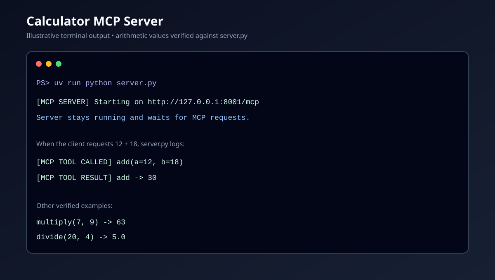
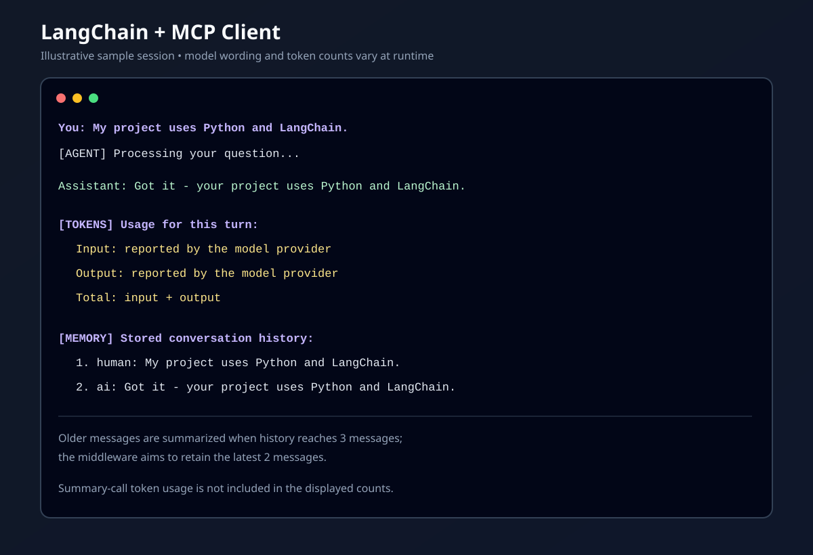

# My Calculator MCP Project

A beginner-friendly proof of concept that demonstrates how a language model can
use calculator tools exposed by an MCP (Model Context Protocol) server. The
client is built with LangChain and Groq. It also keeps short-term conversation
history and summarizes older messages to limit how much history is sent to the
model.

> This project is for learning and experimentation. It is not a production
> chatbot or an authentication service.

## What problem does this project solve?

A language model can answer questions in natural language, but it cannot
reliably perform calculations by itself. The model can decide that a calculator
operation is needed, but a separate tool needs to perform that operation and
return the result.

This project demonstrates that connection:

```text
You → LangChain client and Groq model → MCP calculator tool → result → You
```

The client also keeps messages from the current chat so follow-up questions can
refer to earlier turns. Sending an unlimited transcript repeatedly can increase
input token usage, so the client uses LangChain's `SummarizationMiddleware` to
summarize older messages when the configured message threshold is reached.

## What the application does

- Runs an MCP server that provides calculator functions.
- Connects a LangChain agent to that MCP server over Streamable HTTP.
- Uses a Groq-hosted chat model to understand requests and decide whether to
  call a tool.
- Keeps conversation history in the running client process.
- Summarizes older conversation messages when the history reaches the configured
  threshold.
- Prints tool activity, saved history, and reported per-turn token counts.

## Request flow

1. You type a request in the terminal client.
2. The client sends the request along with its current conversation history to
   the LangChain agent.
3. The Groq model decides whether to answer directly or request a calculator
   operation.
4. If a tool is needed, the agent calls it through the MCP client. The MCP
   server runs the function and returns its result.
5. The model uses the result to produce an answer.
6. The client prints the answer and updates its in-process history.
7. Before model processing, the summarization middleware checks whether the
   message threshold has been reached. When it summarizes, it uses the
   configured chat model to create a summary.

## Conversation history and summarization

The current settings in `client.py` are:

```python
trigger=("messages", 3)
keep=("messages", 2)
```

- **Trigger: 3 messages.** The middleware checks the message count before a
  model call. This counts individual messages—not user-assistant exchanges.
- **Keep: 2 messages.** When summarization runs, it aims to keep the latest two
  messages detailed and replace older history with a summary.
- **Tool interactions:** Assistant tool calls and tool results are also
  messages. LangChain preserves related tool-call/result messages together,
  which can mean more than two messages remain.
- **Where history lives:** History is held in a Python list in the client
  process. It is not written to a database or restored after restarting the
  client.
- **Summary behavior:** Summaries are compressed representations of earlier
  messages, not exact transcripts. Important details may be omitted.
- **Extra model usage:** Creating a summary requires an additional call to the
  configured Groq model. This call can use tokens and may add latency.

The message threshold is intentionally small for this learning example. It is
not a recommended production token or context policy.

## Token reporting

After each turn, the client displays input, output, and total token counts when
the model response includes usage metadata. If a turn involves multiple agent
model responses—for example, a tool call—the reported counts are added together.

The display does **not** include tokens used by the summarization middleware's
separate summary-generation call. If usage metadata is unavailable, the client
reports that usage was not provided rather than estimating a count.

## Requirements

- Python 3.13 or newer
- [uv](https://docs.astral.sh/uv/getting-started/installation/)
- A Groq account and API key
- Git

The project dependencies and their compatible minimum versions are listed in
`pyproject.toml`; `uv.lock` records the resolved dependency versions.

## Setup

### 1. Clone the repository

```bash
git clone https://github.com/kansal-mukul/my-calculator-mcp-project.git
cd my-calculator-mcp-project
```

### 2. Create the project environment and install dependencies

From the project directory, run:

```bash
uv sync
```

`uv run` uses the project's virtual environment, so you do not need to activate
it manually.

### 3. Configure the Groq API key

Copy `.env.example` to `.env`.

PowerShell:

```powershell
Copy-Item .env.example .env
```

macOS/Linux:

```bash
cp .env.example .env
```

Edit `.env` and replace the placeholder with your Groq API key:

```env
GROQ_API_KEY=your_groq_api_key_here
GROQ_MODEL=openai/gpt-oss-20b
```

`GROQ_API_KEY` is required. `GROQ_MODEL` is optional; if omitted, the client
uses `openai/gpt-oss-20b`. Use a model name available to your Groq account.

Keep your real `.env` file private. Do not commit or share your API key. The
repository ignores `.env` files.

## Run the application

The MCP server and client run in separate terminals.

### 1. Start the MCP server

In the first terminal, from the project directory:

```bash
uv run python server.py
```

The server listens locally at:

```text
http://127.0.0.1:8001/mcp
```

Keep this terminal open.

### 2. Start the chatbot client

In a second terminal, from the same project directory:

```bash
uv run python client.py
```

The client checks for the API key, connects to the MCP server, lists the
available tools, and starts an interactive chat.

Example:

```text
You: What is 12 + 18?
Assistant: 30
```

Try a follow-up question to see that earlier conversation context is available:

```text
You: Remember that my favorite color is blue.
You: What is my favorite color?
Assistant: Blue.
```

The client prints `[MEMORY]` entries after each response so you can inspect the
messages currently stored in the conversation state. It also prints `[TOKENS]`
usage when the model provides it. Type `exit` to close the client; its history
is then lost.

## Calculator tools

The MCP server in `server.py` exposes:

| Tool | Purpose |
| --- | --- |
| `add(a, b)` | Adds two numbers |
| `subtract(a, b)` | Subtracts the second number from the first |
| `multiply(a, b)` | Multiplies two numbers |
| `divide(a, b)` | Divides the first number by the second; division by zero raises an error |
| `validate_call(token, message)` | Demo tool that returns the supplied values and `validated: true` |

`validate_call` is only a demonstration. It does not authenticate or validate
the token.

## Project files

| File or directory | Purpose |
| --- | --- |
| `client.py` | Interactive LangChain/Groq client, MCP connection, history, summarization, and usage display |
| `server.py` | MCP server and calculator tool definitions |
| `pyproject.toml` | Project metadata and dependency requirements |
| `uv.lock` | Locked dependency versions used by `uv sync` |
| `.env.example` | Example environment variable configuration |
| `docs/screenshots/` | Example server and client screenshots |

## Troubleshooting

### `GROQ_API_KEY is missing`

Check that `.env` exists in the project root and contains a valid
`GROQ_API_KEY`. Restart the client after editing the file.

### The client cannot connect to the MCP server

Make sure `uv run python server.py` is still running in the first terminal.
Confirm that port `8001` is available and that the client is configured for
`http://127.0.0.1:8001/mcp`.

### Module not found or dependency errors

Run `uv sync` from the project root, then launch scripts with `uv run`, for
example:

```bash
uv run python client.py
```

Running `python client.py` directly can select a different Python environment
that does not have the project dependencies installed.

### Groq connection or certificate errors

The client uses `truststore` to verify HTTPS using the operating system's
trusted certificates; it does not disable certificate verification. If
`uv sync` fails with a certificate issuer error, try:

```bash
uv sync --system-certs
```

If a certificate verification error persists on a network that inspects HTTPS,
ask your network administrator how to install that network's trusted root
certificate. Do not disable TLS certificate verification.

## Limitations

- Conversation history is temporary and belongs to one running client process.
  Exiting the client clears it.
- This terminal application has no user accounts, authentication, or
  multi-user/session isolation.
- The middleware limits history by **message count**, not by a fixed number of
  user-assistant exchanges or a strict token budget.
- Summarization is lossy: the model may omit information from older messages.
- Summary generation uses the same configured model and adds model usage and
  latency. Its token usage is not included in the current `[TOKENS]` display.
- MCP tool results and tool-call messages can affect the history size.
- The calculator server listens on localhost and is intended for local
  experimentation, not public deployment.
- Model availability, response quality, token reporting, and API costs depend
  on the selected Groq model and your Groq account.

## Screenshots

### MCP server startup



### Client interaction



## License

This project is licensed under the [MIT License](LICENSE).

## Contributing

Contributions are welcome. See [CONTRIBUTING.md](CONTRIBUTING.md) for
development and pull request guidelines.
